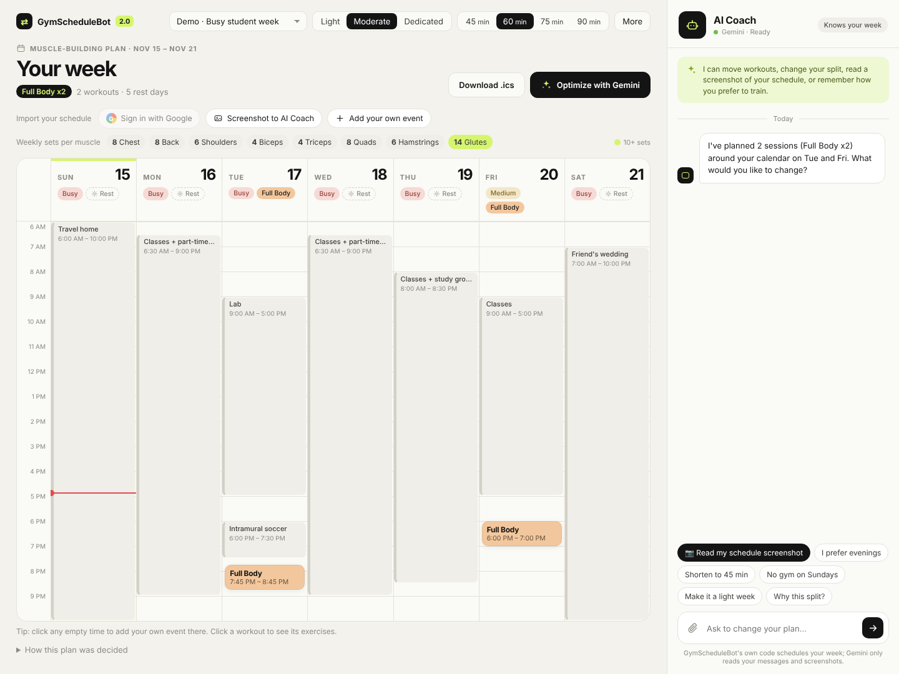

# GymScheduleBot 2.0

**A muscle-building planner that reads your schedule and fits the right training split into your next 7 days.**

Most people don't skip the gym because they're lazy. They skip because their week got busy and their plan didn't change with it. GymScheduleBot 2.0 looks at when you're actually free, then picks a muscle-building split you can finish, following two rules:

1. **Train every muscle twice a week.**
2. **Rest each muscle at least 48 hours between sessions, ideally 72.**

| Sessions that fit | Split | Each muscle trained |
|---|---|---|
| 2 | Full Body ×2 | 2× |
| 3 | Full Body ×3 | 3× |
| 4 | Upper/Lower ×2 | 2× |
| 5 | Push/Pull/Legs + Upper/Lower | 2× |
| 6 | Push/Pull/Legs ×2 | 2× |

A busy person automatically gets two full-body days. A dedicated lifter with an open week gets PPL ×2. Splits that train a muscle only once (Push/Pull/Legs ×1, Upper/Lower ×1, Full Body ×1) are used only when nothing else fits, and the plan says so.

**Live demo:** [gymschedule-bot-2-0.onrender.com](https://gymschedule-bot-2-0.onrender.com/) (free hosting, so the first load can take up to a minute)



## Features

- **Three ways to bring in your schedule:**
  1. **Sign in with Google** to plan around Google Calendar (OAuth, reads **free/busy only**, never event details).
  2. **Send a screenshot** of a class timetable or calendar to the AI Coach. Gemini reads it and adds each class or shift as a weekly event.
  3. **Add your own events**, like in Google Calendar: click any empty time in the calendar, name it, and make it weekly or one-time. Click an event to edit or delete it. Your events are saved in your browser, so no account is needed.

  Built-in demo weeks let anyone try it without signing in.
- **Built for muscle building:** hypertrophy sets and reps (mostly 6–12 on compounds, 10–15 on isolation work), every muscle trained twice a week with 48–72 hours of rest, and a **weekly sets per muscle** counter that highlights muscles reaching 10+ sets.
- **Choose your workout length:** 45, 60, 75 or 90 minutes. The workout changes to fit: shorter sessions trim sets (isolation work first), longer ones add sets to the big lifts first.
- **AI Coach chat:** tell it "I prefer mornings", "shorten to 45 min" or "soccer on Tuesdays 6–7:30pm" and the week re-plans instantly. Gemini turns each message into structured setting changes (and answers questions like "why this split?"); without an API key, a rule-based parser does the same job.
- **Remembers how you train:** preferences are saved in your browser session, so next week's plan already knows them.
- **A real calendar view:** like Google Calendar, each day is a column of hours with your events and workouts placed at their actual times (and a line showing the current time). Each day is tagged Light / Medium / Busy. Click a workout for its exercises.
- **Recovery measured in hours:** sessions sharing a muscle start at least 48 hours apart (so Monday 9 PM and Wednesday 6 AM, only 33 hours, isn't allowed), and the planner prefers 72.
- **Respects real life:** always plans the next 7 days starting today, with a travel buffer around every event, earliest/latest workout times, a preferred time of day, and no times that have already passed.
- **Export:** one click to add workouts to Google Calendar, or download an `.ics`.
- **Explains itself:** every plan shows why that split was chosen.

## How it works

```
 calendar source ──► busy blocks ──► free slots ──► choose split ──► place sessions ──► weekly plan
 (Google / your events /             (availability.py) (splits.py)    (planner.py)          │
  screenshot / demo)                                                                                     ▼
 AI Coach message ──► Gemini / rule parser ──► saved settings                  coach reply, .ics,
                      (assistant.py)            (settings.py)                    Google Calendar events
```

**Design decision: AI translates, code decides.** The language model only turns chat messages into structured setting changes (validated against a JSON schema) and writes the coach's reply; the facts in each reply (split, days, times) come from code. Every scheduling decision is made by deterministic, unit-tested Python. That makes plans predictable and testable, keeps API costs tiny, and lets the whole app work with no API key.

### The scheduling algorithm

1. **Free slots** (`app/scheduler/availability.py`): for each day, pad every busy block with the travel buffer, clip to the allowed window, sort and merge overlapping intervals, and keep the gaps long enough for a session. O(B log B) per day.
2. **Session target:** `min(commitment cap, days with a free slot)`. The caps are Light 2, Moderate 4, Dedicated 6.
3. **Placement** (`app/scheduler/planner.py`): for each candidate split, try every way of placing its sessions on the free days, and on each day up to 3 start times (closest to your preferred time, earliest, latest). That's at most C(7,k) × 3^k options (about 5,000 for 6 sessions), so the planner checks them all in a few milliseconds. It rejects any placement where two sessions sharing a muscle start under 48 hours apart, and scores the rest by:
   - **rest:** every hour short of the ideal 72 hours costs a little
   - **spacing:** variance of the gaps between sessions, so Mon/Thu beats Mon/Tue
   - **time preference:** hours away from the preferred time of day
4. **Fallback:** if no split fits, try one fewer session. Splits that train every muscle twice are always tried first. For example, with only Mon/Tue/Wed free, Full Body ×3 can't get 48 hours of rest, and Push/Pull/Legs would train each muscle once, so you get Full Body ×2 on Monday and Wednesday.
5. **Workout length** (`fit_to_duration` in `splits.py`): sessions are sized to about 2.5 minutes per working set plus a 5-minute warm-up (45 min ≈ 16 sets, 60 ≈ 22, 90 ≈ 30, since extra time becomes longer rests once the big lifts reach 5 sets and the rest reach 4).

### Training science

- **Recovery:** sessions that train the same muscle start at least 48 hours apart, following the American College of Sports Medicine guideline of at least 48 hours between sessions for the same muscle group ([ACSM, 2014](https://www.unm.edu/~lkravitz/Article%20folder/frequency.html)). The planner prefers 72 hours when the schedule allows.
- **Frequency:** splits are chosen so each muscle is trained about twice a week when the schedule allows, based on Schoenfeld, Ogborn & Krieger (2016), ["Effects of Resistance Training Frequency on Measures of Muscle Hypertrophy,"](https://doi.org/10.1007/s40279-016-0543-8) *Sports Medicine* 46:1689–1697. That's why the planner always prefers splits that train every muscle twice, even if that means fewer sessions.
- **Volume:** the weekly sets counter uses a target of about 10 direct sets per muscle per week, a common muscle-building guideline (Schoenfeld, Ogborn & Krieger, 2017, ["Dose-response relationship between weekly resistance training volume and increases in muscle mass,"](https://doi.org/10.1080/02640414.2016.1210197) *Journal of Sports Sciences* 35(11):1073–1082). It counts only sets where the muscle is the main target, so arms look lower than they are: presses and rows also train triceps and biceps.

## Tech stack

Python 3.11+ · FastAPI · Jinja2 · Google Calendar API (OAuth 2.0 with PKCE) · Google Gemini API (structured JSON output) · icalendar · pytest · ruff · GitHub Actions

## Run it locally

```bash
git clone https://github.com/kaiwakura/GymSchedule-Bot-2.0.git
cd GymSchedule-Bot-2.0
python -m venv .venv && source .venv/bin/activate   # Windows: .venv\Scripts\activate
pip install -r requirements-dev.txt
cp .env.example .env          # optional: works with no keys at all
uvicorn app.main:app --reload
```

Open http://localhost:8000 and try the **Busy student week** demo.

Run the tests and linter:

```bash
pytest -q
ruff check . && ruff format --check .
```

### Optional: turn on AI

Add `GEMINI_API_KEY=...` to `.env` (get a free key at https://aistudio.google.com/apikey). The model is set by `GEMINI_MODEL`. Note: on Gemini's free tier, Google may use requests to improve its products, so the app only sends your chat messages, schedule screenshots you choose to upload, and a summary of the plan (split, workout days and times). It never sends your Google Calendar events.

### Optional: connect Google Calendar

1. In [Google Cloud Console](https://console.cloud.google.com/), create a project and **enable the Google Calendar API**.
2. **OAuth consent screen:** choose External, add the scopes `calendar.freebusy` and `calendar.events`, and add your own Google account as a **test user**.
3. **Credentials → Create OAuth client ID → Web application.** Add an authorized redirect URI for each place the app runs, e.g. `http://localhost:8000/auth/google/callback` and `https://<your-app>.onrender.com/auth/google/callback`.
4. Locally: put the client ID and secret into `.env` as `GOOGLE_CLIENT_ID` and `GOOGLE_CLIENT_SECRET`, then restart the server.
   Deployed: set `GOOGLE_CLIENT_ID`, `GOOGLE_CLIENT_SECRET` and `GOOGLE_REDIRECT_URI` (the deployed callback URL) as environment variables. Don't set `OAUTHLIB_INSECURE_TRANSPORT` there.

While the app is in Google's "Testing" mode, only the test users you add can sign in (up to 100), and their sign-in lasts 7 days. That's why the demo calendars exist: anyone can try the planner without Google.

## Project structure

```
app/
  main.py                 FastAPI routes: page, toolbar, AI Coach chat API, Google sign-in
  settings.py             a visitor's saved settings (session cookie), validated on every load
  views.py                plan -> day columns (busyness tags, events, workout/rest cards)
  models.py               shared data types
  scheduler/
    availability.py       busy blocks -> free slots
    splits.py             split definitions + choice rules
    planner.py            recovery-aware placement + fallback
  sources/
    google_calendar.py    OAuth, free/busy, add events
    custom.py             your own events: validation + expanding weekly/one-time events
    ics.py                .ics export of the plan (plus an .ics reader kept for future imports)
    demo.py               sample weeks
  ai/assistant.py         AI Coach: Gemini structured output + rule-based fallback
  templates/              page + the re-renderable plan partial
  static/                 style.css, app.js (chat, toolbar, workout details; no build step)
tests/                    unit + integration tests
```

## Roadmap

- [ ] **"I missed a session":** re-plan the rest of the week from today
- [ ] **Carry recovery across weeks:** last week's Sunday legs should affect this Monday
- [ ] **Progress tracking:** log sets and weights, with progressive overload suggestions
- [ ] **Store users in a database:** SQLite or Postgres instead of cookie sessions + browser storage, so your events follow you across devices
- [ ] **Weekly auto-planning:** a Sunday-night job that adds next week's plan automatically
- [x] **Deploy:** live on Render (`uvicorn app.main:app --host 0.0.0.0 --port $PORT`)
- [x] **AI Coach chat** that changes and remembers preferences
- [x] **Schedule screenshots** read by Gemini
- [x] **Your own events** (weekly or one-time), like Google Calendar

## Security notes

- Reads only free/busy data from Google, never event titles or descriptions.
- OAuth uses `state` and PKCE. The user's own tokens live in a signed session cookie (fine for a demo; a production version would store them encrypted server-side). The app's client secret never leaves the server.
- Secrets come from environment variables, and `.env` is git-ignored.

## License

MIT
